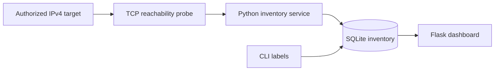

# 🕸️ SpiderNet — Network Inventory Dashboard

**Discover. Inventory. Monitor.** A Python + SQLite network inventory project with a Flask dashboard, inspired by a home-network visibility lab.

  

> **Original project evidence:** My September 2026 Spider-Net dashboard ran in Proxmox VM 101 with a Flask web application and a systemd scanner service. The original screenshots show online/known/unknown counts, IP/MAC inventory, first/last-seen timestamps, and a device-renaming interface. The source code in this repository is a **new portfolio implementation**, not the original deployed source; features differ. See [Original deployment and evidence](docs/original-deployment.md).

> **Portfolio implementation:** This repository contains a clean, runnable implementation based on my SpiderNet project concept and prior lab work. It is not presented as the exact original codebase. Test and validate it in your own environment before relying on results.

## Original deployment (September 2026)

The original dashboard screenshots show **18 devices online, 16 known devices, and 26 unknown devices** at the moment captured. These are historical dashboard counters, not live metrics and not a claim that the current repository implementation reproduced them. The Proxmox console shows a `spidernet-scanner.service` systemd unit active at capture time and a separate `spidernet-web.service` unit configured. For a precise distinction between the original and rebuilt versions, read [deployment notes](docs/original-deployment.md).

**Privacy:** Original captures contain home-network identifiers. Public-safe redacted copies are being prepared separately; unredacted screenshots should not be committed.

## Features

- Scan an **explicitly authorized** IPv4 network or individual host, with a maximum of 256 addresses per scan
- Probe a small set of common TCP ports to infer whether a device is reachable
- Resolve hostnames when reverse DNS is available
- Record discovered devices and scan timestamps in SQLite
- Mark known/unknown devices and add a friendly name
- Browse a responsive, red-and-navy themed Flask dashboard
- Show recent inventory and scan history

**Detection caveat:** A host that does not answer TCP probes is **not necessarily offline**. MAC addresses are not collected by this implementation; they are stored only when entered manually. Scans are not continuous and do not capture all devices.

## Quick start

```bash
git clone https://github.com/noahblanny/spidernet.git
cd spidernet
python3 -m venv .venv
source .venv/bin/activate
pip install -r requirements.txt
python -m spidernet init
python -m spidernet scan 192.168.1.0/28  # replace with a network you own or are authorized to assess
python -m spidernet serve
```

Open **http://127.0.0.1:5000** on the same computer. The dashboard binds to localhost by default and has **no authentication**; do not expose it to the internet.

## Commands

```bash
python -m spidernet init
python -m spidernet scan 192.168.1.10
python -m spidernet scan 192.168.1.0/28
python -m spidernet devices
python -m spidernet label 192.168.1.10 --name "My laptop" --known
python -m spidernet serve
```

Optional: set `SPIDERNET_DB` to choose a different SQLite database path.

## Architecture



## Repository structure

- `spidernet/` — CLI, scanner, storage and web dashboard
- `tests/` — Basic tests
- `docs/` — Design decisions, limitations, and roadmap
- `assets/` — Spider-inspired project banner

## Safety and privacy

Only scan networks you own or have explicit permission to assess. Do not upload real inventory databases, internal addresses, hostnames, or MAC addresses from your environment. The default `.gitignore` excludes local databases.

## Roadmap

- [ ] Add optional authenticated local ARP inventory for MAC discovery
- [ ] Add scan comparisons and richer device history
- [ ] Add authenticated dashboard access before any remote deployment
- [ ] Add export and import of sanitized inventory
- [ ] Add tested Suricata event correlation

Built for hands-on learning in network visibility, Python automation, SQLite and security operations.
